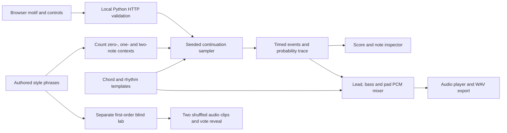

# Phrase Studio · application design

## 1. Problem and users

A beginner has three notes and wants to hear how they could become a piece. A teacher wants to show exactly where the student's input ends and generation begins. Success means the opening survives, the result plays, and a student can explain one sampled choice. Unexpected playback, silent replacement of the motif, and claims that a listener voted a particular way are unacceptable.

## 2. Why generative AI and which kind

| Decision criterion | Consequence |
|---|---|
| Multiple valid answers | Sample continuations so students can explore variations. |
| Available examples | Short authored monophonic phrases support estimating local pitch patterns. |
| Control | Preserve the motif, expose tempo and use a seed for replay. |
| Cost of a mistake | Auditioning a weak melody costs seconds. Playback is opt-in. |
| Measurable benefit | Compare next-note prediction to independent pitch frequencies and collect blind preferences. |

Use a conditional statistical generator trained from scratch. Text prompting and retrieval do not supply a pitch distribution, and this corpus is too small to justify neural fine-tuning. A deterministic backing gives both replayability and a clear distinction between learned pitches and arranged harmony. These five project criteria should be mapped to the instructor’s exact terminology when available.

## 3. Scope

Two styles, one to four natural-note motif pitches from C4 to C5, four bars in 4/4, and WAV export. The browser can also run an unaccompanied listening experiment. Arbitrary lyrics, recorded audio and artist imitation fall outside scope. Invalid controls return HTTP 400 and an actionable message. No accounts or persistent voting.

## 4. Requirements

| Requirement | Acceptance target |
|---|---|
| Creative control | Preserve every input pitch in order. Replaying identical controls produces identical notes. Each tested slice yields at least two variants over ten seeds. |
| Rendering and export | Score covers 32 eighth-note ticks. Mono 16 kHz PCM contains the expected number of frames for 16 beats at the selected tempo. |
| Explanation | Every sampled note exposes its context order and normalized post-weighting candidates. Motif notes are identified separately. |
| Audience comparison | Hide generator labels until both clips end and a listener votes. Include a tie option. |
| Latency and cost | Target under 1 second to generate and render a typical local arrangement. Zero per-request provider fees. |
| Privacy, freshness, rights | Bind to loopback. Data stays on the machine; HTTP logs contain request parameters. Corpus is versioned with the code and updated at release time. Use project-authored exercises and synthesized audio. |

## 5. Architecture

The model fits nine eight-note phrases per style without crossing phrase boundaries. At each new onset it tries the last two pitches, then the last pitch, then the style-wide counts. On integer beats it doubles the count of candidates in the bar's chord and normalizes before sampling. The seed controls rhythm template selection and pitch sampling. Each bar consumes eight ticks. The mixer places each voice on the same sample clock. No external inference or database is required. The blind lab uses only the original three phrases per style so its existing first-order comparison remains reproducible.

## 6. Failure modes and guardrails

An unseen motif triggers shorter context; even four identical notes remain valid. The small corpus can replay fragments and yields overconfident choices. The inspector exposes when only one successor was observed. Chord weighting nudges pitches but cannot ensure smooth endings. Fixed length, bounded tempo and motif validation bound render work. Score and saved examples support a projector or server failure. Page-source inspection can spoil blinding. Local voting is suitable for a class activity, not a controlled research trial.

## 7. Evaluation

| Stage | Procedure and observed result |
|---|---|
| Pitch prediction | Leave one complete phrase out, train on eight, repeat nine folds per style. Score seven next-note targets per held-out phrase (63/style). Add one count to each of eight possible pitches for scoring. Lower mean bits/note is better. Bright: unigram **2.700**, context **2.501**. Wistful: **2.758**, **2.429**. This measures the pitch model before harmonic weighting. |
| Arrangement | Both styles × 3 motifs × 3 tempos × 10 seeds = **180 cases**. Check prefix, supported pitches, total duration, reproducibility, candidate sums and variation. |
| Render | Verify exact WAV frame counts at 64, 108 and 160 BPM. Observed generation plus rendering at 108 BPM was about 0.25 s on the demo machine. |
| Listening lab | 80 cases. Familiar adjacent pairs: learned **600/600**, baseline **272/600**. This measures adherence to the tiny training set. |
| Human review | Ask three listeners for five shuffled A/B judgments each. Tally learned, baseline and ties on paper. Target 10/15 learned preferences as an exploratory goal. Results are pending. |

Launch targets: all functional assertions pass, valid WAV export and browser playback work, and held-out context loss beats the unigram baseline in both slices. Musical preference is a separate outcome. Do not treat a small in-class vote as evidence of general superiority.

## 8. Open questions and risks

Do longer contexts improve phrasing or mainly increase copying? Compare contiguous overlap as the corpus grows. Does musical training affect preferences? Record it voluntarily in a future listening study. Does the class identify the intended style blind? Ask separately from preference. A corpus of 18 short phrases supports a classroom demonstration, not claims about music broadly.
